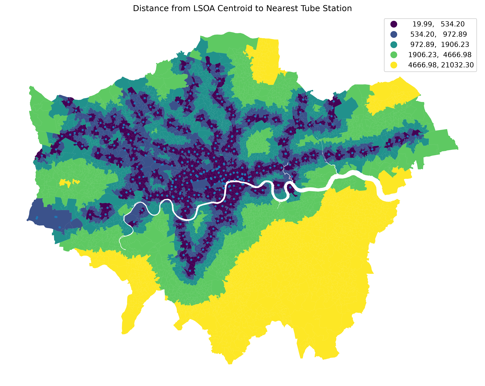
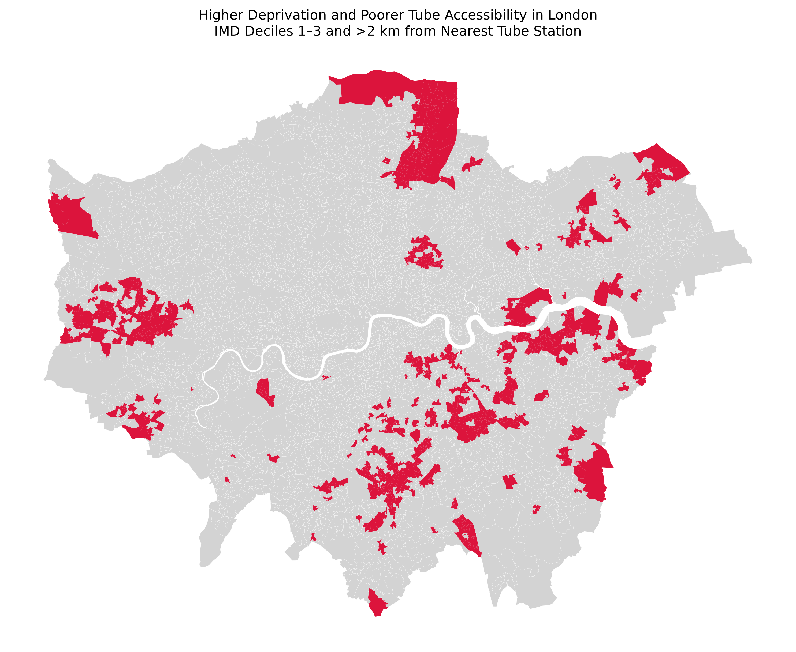
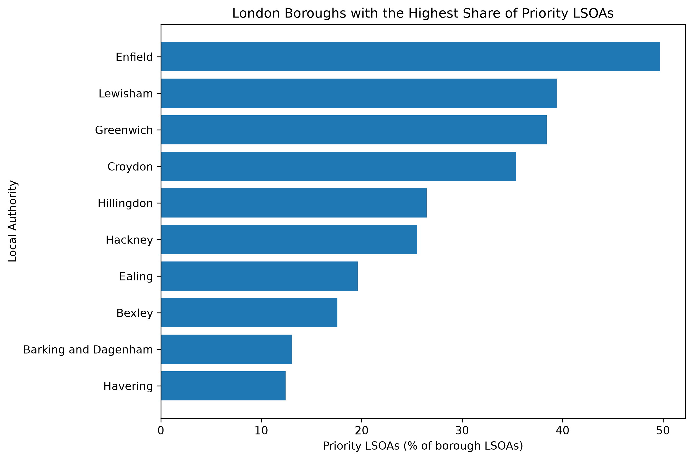

# London Public Transport Accessibility and Socioeconomic Inequality

## Overview

This project investigates spatial inequalities in public transport accessibility across London and explores how these patterns are associated with socioeconomic deprivation.

The project is developed as an urban spatial data science portfolio project using reproducible Python-based spatial analysis and official open data.

Version 1 (V1) focuses specifically on accessibility to London Underground (Tube) stations as an initial and transparent accessibility measure. Future versions will extend the analysis to a broader range of public transport modes.

## Research Question

**How does public transport accessibility vary across London neighbourhoods, and how is it associated with socioeconomic deprivation?**

For V1, this broader question is investigated using Tube accessibility as the initial accessibility indicator.

## Study Area and Spatial Unit

- Study area: Greater London
- Primary spatial unit: 2021 Lower Layer Super Output Areas (LSOAs)
- Number of London LSOAs analysed: 4,994
- Coordinate reference system for spatial analysis: British National Grid (EPSG:27700)

## Data

V1 uses:

- 2021 LSOA boundaries — Office for National Statistics (ONS)
- LSOA to Local Authority District lookup — Office for National Statistics (ONS)
- English Indices of Deprivation 2025 — UK Government
- London Underground station data — Transport for London (TfL)

Raw and processed datasets are not stored in this repository. The analysis scripts are designed to keep the workflow reproducible while separating source data from code.

## Methodology

### 1. Prepare London LSOAs

2021 LSOA boundaries were filtered to Greater London using the LSOA-to-Local-Authority lookup.

The final study area contains 4,994 LSOAs across London's 33 local authorities.

### 2. Construct Tube Accessibility Indicators

Two simple and interpretable Tube accessibility indicators were calculated for each LSOA:

- **Distance to nearest Tube station** — distance from the LSOA centroid to the nearest Tube station, measured in metres.
- **Tube stations within 800 m** — number of Tube station records located within an 800 m buffer around the LSOA centroid.

These indicators represent proximity and local availability respectively.

### 3. Integrate Socioeconomic Deprivation

The accessibility dataset was joined with the English Indices of Deprivation 2025 using LSOA codes.

All 4,994 London LSOAs were successfully matched.

IMD deciles are interpreted as:

- **1 = most deprived**
- **10 = least deprived**

### 4. Analyse Accessibility Inequality

Tube accessibility was compared across IMD deciles using:

- descriptive statistics
- median accessibility by IMD decile
- boxplots
- Spearman rank correlations
- spatial mapping

### 5. Identify Priority Areas

A simple priority-area classification was created to identify neighbourhoods experiencing both relatively high deprivation and poor Tube proximity.

An LSOA is classified as a priority area when:

- IMD decile is **1–3**, and
- distance to the nearest Tube station is **greater than 2 km**

This definition is intended as an exploratory analytical rule rather than an official policy classification.

## Key Results

### Tube Accessibility Across London

Distance to the nearest Tube station varies substantially across London, with poorer Tube proximity particularly visible in parts of outer London.

### Accessibility and Deprivation

To identify areas experiencing both socioeconomic disadvantage and poorer Tube proximity, V1 defines priority LSOAs as neighbourhoods in IMD deciles 1–3 that are more than 2 km from the nearest Tube station.

The analysis identifies **620 priority LSOAs**, representing **12.4% of London LSOAs**.

### Borough-Level Comparison

The concentration of priority LSOAs varies considerably between London boroughs.

Enfield has the highest share under this study-defined measure, with **49.7%** of its LSOAs classified as priority areas, followed by Lewisham (**39.4%**), Greenwich (**38.4%**) and Croydon (**35.4%**).

## Key Findings

The V1 analysis identifies substantial spatial variation in Tube accessibility across London.

The relationship between deprivation and Tube accessibility is not strongly linear across all London neighbourhoods. Spearman correlations between IMD rank and the two Tube accessibility indicators are relatively weak.

However, the distribution of accessibility varies across deprivation groups. In particular, the least deprived IMD decile contains neighbourhoods with substantially greater distances to the nearest Tube station.

The priority-area analysis identified:

- **620 LSOAs** meeting the combined high-deprivation and poor-Tube-accessibility criteria
- **12.4% of all London LSOAs**

The highest shares of priority LSOAs were found in:

- Enfield — **49.7%**
- Lewisham — **39.4%**
- Greenwich — **38.4%**
- Croydon — **35.4%**

These results show that the spatial relationship between deprivation and Tube accessibility is geographically uneven and cannot be adequately described by a single London-wide correlation coefficient.

## Outputs

V1 produces a set of maps and statistical visualisations, including:

- Tube accessibility maps
- IMD deprivation map
- median Tube distance by IMD decile
- Tube-distance boxplots by IMD decile
- priority-area map
- local-authority comparison of priority LSOA percentages

Figures are stored in:

`outputs/figures/`

Maps are stored in:

`outputs/maps/`

## Limitations

V1 measures **Tube accessibility rather than overall public transport accessibility**.

Distance to a Tube station does not capture accessibility provided by:

- buses
- London Overground
- Elizabeth line
- DLR
- trams
- National Rail

The analysis also uses LSOA centroids as representative locations. This simplifies neighbourhood accessibility and does not capture variation within individual LSOAs.

The 800 m station-count indicator measures nearby station records rather than service frequency, travel time, network connectivity or destination accessibility.

The priority-area definition is an exploratory threshold-based classification and should not be interpreted as an official measure of transport disadvantage.

These limitations motivate the development of a broader multimodal accessibility measure in future versions.

## Tools

- Python
- pandas
- GeoPandas
- Matplotlib
- mapclassify
- Git

## Next Steps

Future development may include:

- multimodal public transport accessibility
- bus, Overground, Elizabeth line, DLR and tram services
- service frequency
- public transport travel-time accessibility
- population and Census variables
- network-based accessibility measures
- spatial databases such as PostGIS
- interactive mapping and visualisation

## Project Status

**V1 — Tube accessibility and socioeconomic inequality analysis complete.**

Further development will extend the project toward a multimodal measure of public transport accessibility.